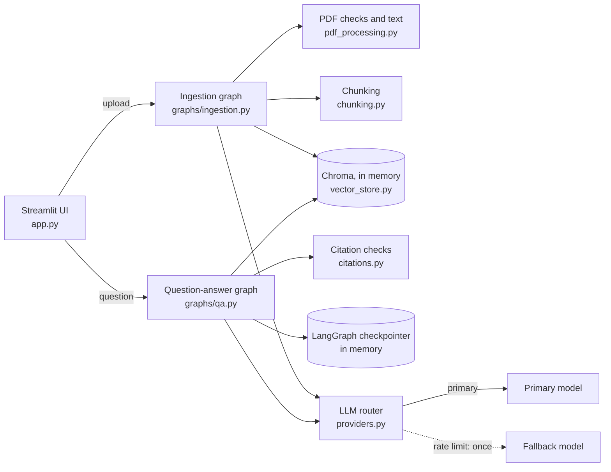
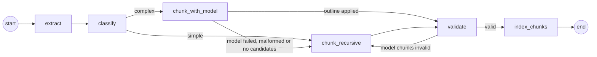
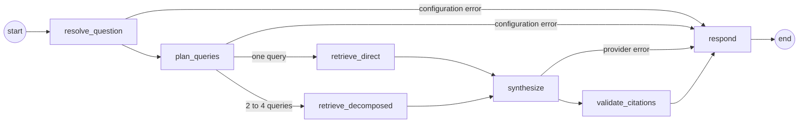

# Architecture

The PDF Knowledge Chatbot is one Streamlit process. A browser session uploads one PDF, which an
ingestion workflow turns into indexed passages; each question then runs through a question-answer
workflow that plans the search, retrieves passages, asks a model for an answer that cites them, and
checks every citation before anything is shown. Both workflows are LangGraph graphs, model calls go
through a provider-neutral router with a fallback, and everything a session creates lives in memory.

## Modules

| Module | Responsibility |
|---|---|
| `app.py` | Streamlit UI: setup screen, upload and progress, chat, sources, reset and replacement. Keeps per-session objects in `st.session_state`. |
| `genai_chatbot/config.py` | `AppSettings` (pydantic-settings) from keyword arguments, environment, `.env`, then Streamlit secrets; turns validation errors into setup issues that never include values. |
| `genai_chatbot/pdf_processing.py` | Upload checks (empty, not a PDF, corrupt, encrypted, no pages, page limit, no text layer), per-page extraction with pypdf, cleaning, and removal of running headers, footers and page numbers. |
| `genai_chatbot/chunking.py` | Complexity assessment, heading detection, section building, recursive and model-assisted chunking, chunk validation. |
| `genai_chatbot/providers.py` | Chat models via `init_chat_model`, structured output, error classification, and `LLMRouter` (primary, then the fallback once on a rate limit). |
| `genai_chatbot/vector_store.py` | `DocumentIndex`: one in-memory Chroma collection per session and document, local all-MiniLM-L6-v2 embeddings, search of up to four passages. |
| `genai_chatbot/citations.py` | Passage labels (P1, P2…), citation validation, renumbering and excerpt selection. |
| `genai_chatbot/prompts.py` | Prompt templates for outlining, follow-up rewriting, planning and answering. |
| `genai_chatbot/schemas.py` | Pydantic models for pages, chunks, plans, drafts, citations, answers and chat turns. |
| `genai_chatbot/observability.py` | Structured logs from an allowlist of scalar fields, with session and request IDs. |
| `genai_chatbot/graphs/ingestion.py` | The document-ingestion graph. |
| `genai_chatbot/graphs/qa.py` | The question-answer graph and `Conversation` (one checkpointer thread per session and document). |

## Document ingestion

1. **extract** checks the upload and returns cleaned text per 1-based page. Problems become a
   `PDFProcessingError` with a message written for the user.
2. **classify** marks a document complex when it has more than 20 pages, three or more table-like lines,
   or a heading hierarchy of at least two levels.
3. **chunk_recursive** (simple documents, and the fallback) builds sections from strong headings
   (numbered headings, 10-K "PART"/"Item" markers, short ALL-CAPS lines), keeps sections up to 1,000
   characters whole and splits longer ones with LangChain's `RecursiveCharacterTextSplitter`
   (1,000 characters, 150 overlap).
4. **chunk_with_model** (complex documents) shows the model up to 400 heading candidates (ID, page and the
   first 100 characters) and asks which ones start sections, at what level, up to 150. The app cuts the
   page text at those lines itself, so the model never rewrites text. Invented IDs make the outline
   malformed.
5. **validate** checks that every chunk belongs to the document, names a real page, has a unique ID and is
   an exact substring of its page. Invalid model chunks fall back to the splitter; invalid splitter chunks
   stop ingestion.
6. **index_chunks** embeds and upserts the chunks in batches, reporting progress.

Every chunk stays within one page, so each source has a single page number, and every chunk is an exact
substring of its page's cleaned text, so excerpts can be shown verbatim. Each node emits progress through
LangGraph's custom stream, which the UI shows in a status box.

## Question answering

1. **resolve_question** rewrites a follow-up ("And what about operating income?") into a standalone
   question using the last eight messages. The first question in a conversation skips the model call. If
   the rewrite fails for a reason other than configuration, the question is used as typed.
2. **plan_queries** returns a `QueryPlan`: whether to decompose, one to four search queries, and a
   response style (prose, bullets or table). Pydantic normalizes the plan (blank and duplicate queries
   dropped, at most four kept). If planning fails, the graph searches once with the question.
3. **retrieve** (a conditional route: direct or decomposed) runs each query against the index, up to four
   passages per query, and drops duplicates by chunk ID and by identical text.
4. **synthesize** sends the passages as `<passage id="P3" section="…">` blocks without page numbers or
   filenames, asks for an `AnswerDraft` (answer, response style, cited passage IDs, supported or
   unsupported), and skips the call when nothing was retrieved.
5. **validate_citations** turns an unsupported draft into a fixed abstention. For a supported draft, every
   cited label must be one of the retrieved passages and at least one must be cited, or the reply becomes
   an abstention that asks the user to rephrase. Valid labels are renumbered `[1]`, `[2]` in order of first
   use, and each source's filename, page and excerpt are copied from the retrieved chunk.
6. **respond** turns any failure into a service message and appends the assistant turn to the
   conversation.

The conversation is stored by LangGraph's `InMemorySaver`, one thread per session and document with a
random suffix, so a reset or a re-upload of the same file starts clean. The chat history the UI renders
and the context the follow-up rewrite reads both come from that thread. The checkpointer's serializer only
revives the app's own Pydantic models.

### Excerpts

The excerpt is the sentence (or table line) of the passage that shares the most words and figures with
the claims citing it, figures counting three times as much as words. A short heading or table row that
matches also takes the following line, and anything over 240 characters is cut at a word with an
ellipsis. Lines
wrapped across the PDF's layout are joined first, and numbered headings and decimals don't split
sentences.

## Models and failover

`create_chat_model` builds every model with LangChain's `init_chat_model(model, model_provider, api_key,
timeout, max_retries=0)`, so the provider is a setting. All calls use structured output into Pydantic
models; for Anthropic the router asks for native JSON-schema output (`method="json_schema"`). No sampling
parameters are set.

`LLMRouter.invoke_structured` calls the primary model. A rate-limit error (HTTP 429, or the provider's
rate-limit exception) switches to the fallback model exactly once. Credential and request errors never
fail over: they are configuration problems, and retrying them elsewhere would hide them. Output that
doesn't parse into the schema counts as malformed and doesn't fail over either. SDK retries are off so a
429 reaches the router immediately. Each failure is classified (`rate_limit`, `auth`, `invalid_request`,
`malformed_output`, `unavailable`) by walking the exception's cause chain, and each class has a plain
user message that names no provider internals.

What each failure means for the user:

| Where | Failure | Result |
|---|---|---|
| Outline (upload) | any model error | Splitter chunks; a bad key or model name also shows a notice |
| Follow-up rewrite | configuration error | Service message |
| Follow-up rewrite | other error | Question used as typed |
| Planning | configuration error | Service message |
| Planning | other error | One search with the question |
| Answer | any error | Service message (both models rate limited, unavailable, malformed, …) |
| Citations | unknown or missing labels | Abstention asking to rephrase |

## State and lifecycle

Per browser session, `st.session_state` holds a session ID, the router, the active document's metadata,
its `DocumentIndex` and its `Conversation`. Streamlit's `file_id` decides whether an upload is new, so
reruns don't re-process the same file.

- **Upload or replacement:** the previous conversation thread and collection are deleted first, then the
  new file is ingested into a new collection named `pdfchat-<session>-<document hash>-<random>`.
- **Reset or file removal:** the thread and collection are deleted, and reset also gives the uploader a
  new key so the widget empties.
- **Failed upload:** the half-built collection is deleted.
- **Abandoned session:** a `weakref.finalize` hook drops the collection when Streamlit discards the
  session's state.

Chroma's ephemeral client keeps all collections in process memory, shared by every session, so isolation
comes from per-session collection names plus a `document_id` filter on every query. Nothing is written to
disk except the embedding model cache.

## Security and privacy

- **Secrets:** API keys are `SecretStr`, never logged or displayed; setup issues name the setting only.
  `.env`, `secrets.toml` and uploaded PDFs are git-ignored, and a test scans tracked files for key
  patterns.
- **Prompt injection:** document text and questions reach models only inside delimited data blocks, and
  every system prompt says to treat that text as data. Passage tags are sanitized so a PDF can't close its
  own tag, and values are inserted after templating so braces can't alter a prompt.
- **Grounding:** the model never supplies source metadata. Citations are passage IDs that must match
  retrieved passages; filenames, pages and excerpts come from the index.
- **Rendering:** answers keep Markdown lists and tables, but images, links and link definitions are
  removed (a planted image could make the browser fetch a URL) and `$` and `~` are escaped. Questions and
  filenames are fully escaped. HTML is never enabled.
- **Data sent to providers:** the question, recent conversation turns (for follow-ups), retrieved
  passages and, for complex documents, heading candidates. Embeddings are computed locally.

## Observability

`log_event` and `log_stage` write one JSON line per event to stderr through the `genai_chatbot` logger. Only
allowlisted keys with scalar values are kept (stage, duration, provider route, provider, model, fallback
use and reason, retrieval and passage counts, query count, route, response style, citation count, page
and chunk counts, strategy, outcome, error kind), always with the session ID and, for an upload or a
question, a request ID. Keys, document text, prompts, questions and excerpts can't be logged by accident:
an unknown keyword argument is dropped. Library loggers that print document details are set to ERROR.

## Testing strategy

- **Unit tests** cover extraction, cleaning, chunking rules, prompts, citations, schemas, settings,
  logging and provider error handling, with PDFs generated by reportlab.
- **Integration tests** run both graphs against the real Chroma index and embedding model, with scripted
  fake models (`tests/support/fake_llm.py`) for failover, malformed output, decomposition, follow-ups and
  citation checks.
- **App tests** drive `app.py` with Streamlit's `AppTest` and a fake router.
- **Browser tests** (Playwright, Chromium, Firefox and WebKit) run the real app with a rule-based stand-in
  model (`tests/support/heuristic_llm.py`) and save screenshots of each state.
- **Evaluation** (`tests/evaluation/`) checks 16 questions about the Microsoft report: their facts and
  expected pages are verified against the PDF without a model, and a manual live run scores real answers
  for answer points, cited pages and abstentions.

The default run is offline and deterministic, with 100% line and branch coverage of `genai_chatbot/` and
`app.py` enforced in CI.

## Alternatives considered

| Decision | Chosen | Alternatives and why not |
|---|---|---|
| Orchestration | Two LangGraph graphs with conditional routes | One prompt per question: simpler, but no planning, decomposition or per-step fallbacks. An agent with tools: less predictable cost and harder to test. |
| Failover | Custom `LLMRouter` | `Runnable.with_fallbacks` can be limited to given exception types, but each provider SDK raises its own; the router classifies errors across providers (types, status codes, cause chains), fails over on rate limits only, and logs which route answered. |
| Complex chunking | Model picks headings, app cuts text | Model rewrites chunks: can alter text and break exact excerpts. Embedding-based semantic chunking: ignores the document's own structure and needs tuning. |
| Citations | Passage IDs resolved by the app | Model-written page numbers and quotes: easy to hallucinate. Highlighting by string search: fragile on reworded answers. |
| Unsupported questions | Model judges support, app validates citations | A similarity threshold: MiniLM scores vary by phrasing, so a threshold either blocks good answers or lets weak ones through. |
| Extraction | pypdf | PyMuPDF: faster and layout-aware but AGPL. pdfplumber: better tables, slower on long reports. |
| Embeddings | Local all-MiniLM-L6-v2 (ONNX) | Hosted embeddings: better on financial text, but send the whole document to another service and need another key. |
| Vector store | In-memory Chroma, one collection per session and document | Persistent Chroma or FAISS on disk: the plan forbids persistence. One shared collection: isolation by filter only. |
| Conversation state | LangGraph checkpointer | `st.session_state` lists: simpler, but the graph would need its own copy of the history. |
| Answer display | Shown when complete | Token streaming: faster first words, but unchecked citations would appear before validation. |
| Browser test model | Rule-based stand-in reading the real prompts | Recorded responses: break whenever a prompt changes. Live models: cost, flakiness and keys in CI. |

## Limits of v1

One document per session; no OCR; tables flattened to text lines; one page per source; no streaming;
memory grows with concurrent sessions. See the README for the user-facing list.
